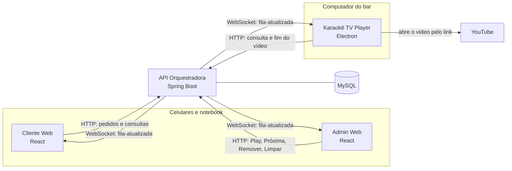
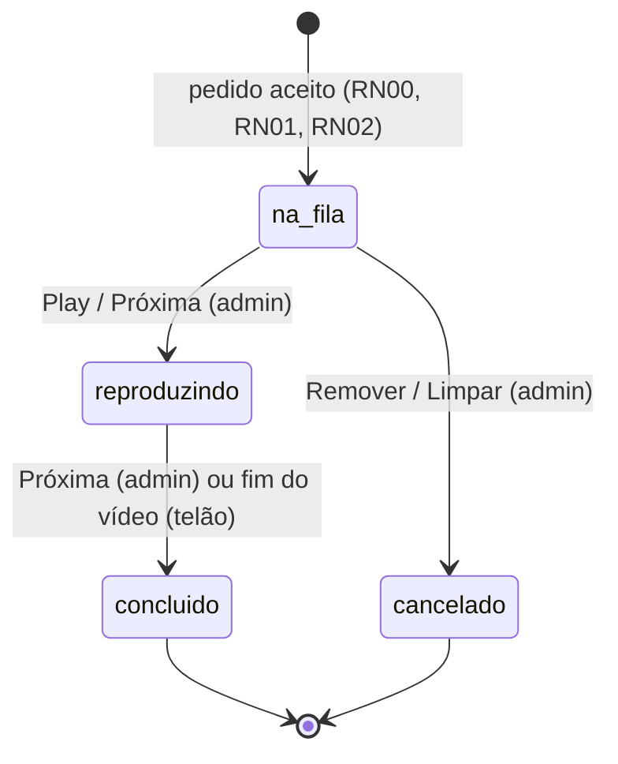
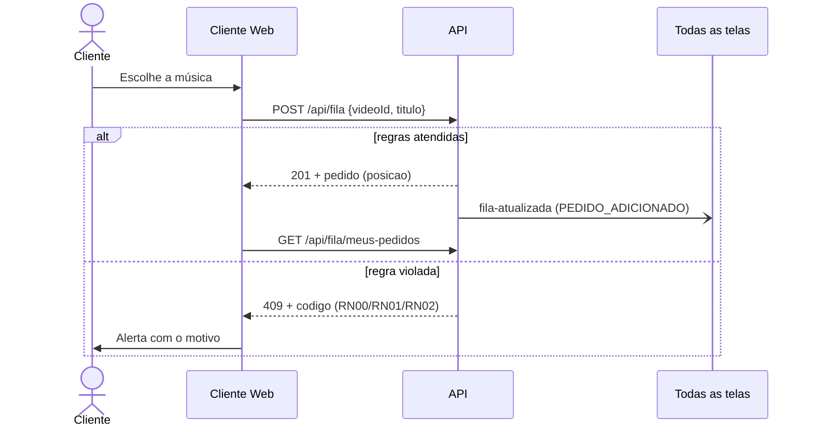
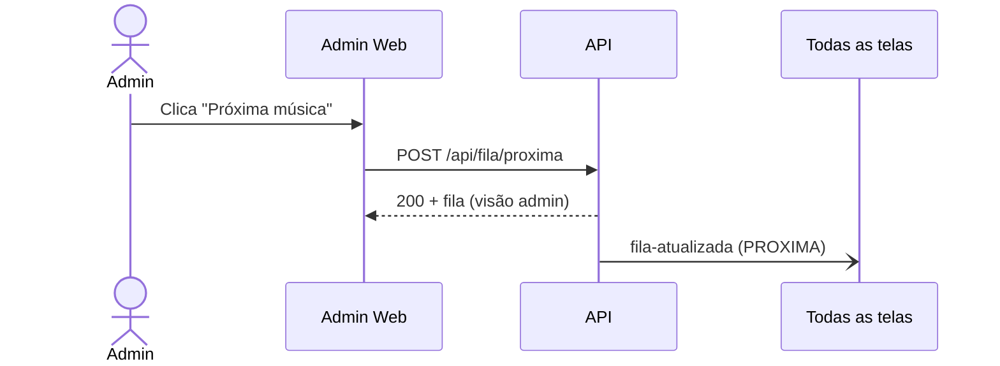
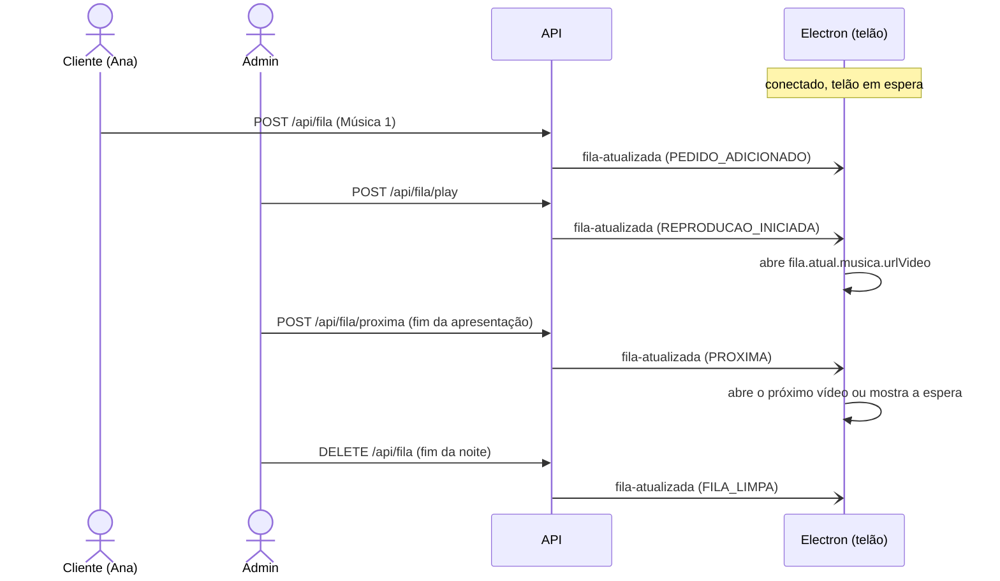
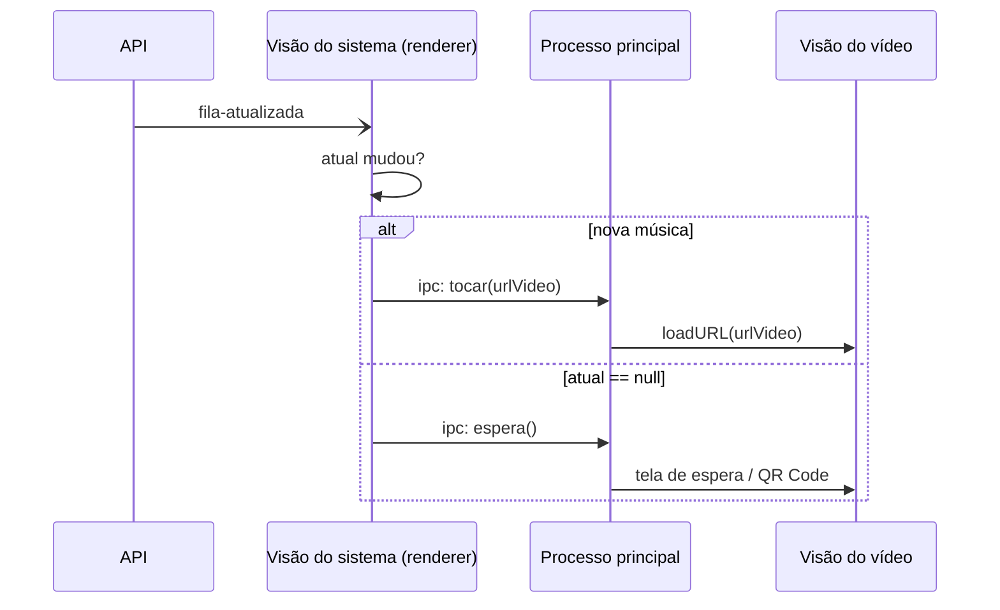

# Guia de Integração — Telas com a API Orquestradora

Guia para quem desenvolve o **Cliente Web**, o **Admin Web** (React + Vite) e o **Karaokê TV Player** (Electron).
Ele descreve o que a API já entrega (cards 1.1, 1.3 e 2.2), como cada tela se conecta e o que ainda vai mudar.

> Referências: `documento.pdf` (Seções 4.1, 4.4, 4.5 e Figuras 6 a 9) e o [README da API](README.md).

---

## 1. Visão geral



Duas regras valem para todas as telas (Seção 4.5):

| Canal | Para quê | Direção |
|---|---|---|
| **HTTP** (`/api/...`) | Toda ação: identificar-se, pedir música, Play, Próxima, Remover, Limpar, fim do vídeo | Tela → API |
| **WebSocket/STOMP** (`/ws`) | Aviso `fila-atualizada` sempre que a fila muda | API → **todas** as telas |

- A tela **nunca** altera a fila pelo WebSocket. Mensagens enviadas pelas telas são recusadas.
- A API é a única dona do estado da fila. A tela só exibe o que recebe.
- Ao abrir e ao reconectar, a tela busca o estado por HTTP (`GET`). Depois disso, é atualizada pelo WebSocket.

### Estado de cada pedido (RN04)



Pedido recusado não é gravado: a API responde com um erro e nada muda na fila.

---

## 2. O que já existe e o que ainda vem

| Recurso | Situação | Card |
|---|---|---|
| Fila: pedir, consultar, Play, Próxima, Remover, Limpar, fim do vídeo | ✅ pronto | 1.3 |
| Aviso em tempo real `fila-atualizada` | ✅ pronto | 2.2 |
| Banco MySQL e ambiente Docker | ✅ pronto | 1.1 |
| Login, cadastro, visitante e token JWT | ⏳ pendente — hoje usa `X-Usuario-Id` (Seção 4) | 1.2 |
| Pesquisa de músicas no YouTube (`GET /api/musicas/busca?q=`) | ⏳ pendente — hoje informe `videoId` e `titulo` direto | 2.1 |
| Gestão do catálogo pelo admin (RF11) | ⏳ pendente | 2.1 |

Isole a autenticação e a busca em um único módulo de cada tela, para que a troca futura não espalhe mudanças.

---

## 3. Ambiente de desenvolvimento

### Subir a API
Na raiz do repositório:

```bash
docker compose up -d --build
```

| O quê | Endereço |
|---|---|
| API (perfil `dev`) | `http://localhost:8080` |
| WebSocket | `ws://localhost:8080/ws` |
| Swagger | `http://localhost:8080/swagger-ui.html` |
| Monitor das mensagens | `http://localhost:8080/dev/monitor-fila.html` |
| Saúde | `http://localhost:8080/actuator/health` |

Dados de desenvolvimento (`BancoDeDados/scripts/02_dados_desenvolvimento.sql`):

| `X-Usuario-Id` | Usuário | Perfil |
|---|---|---|
| `1` | Organizador | admin |
| `2`, `3`, `4` | Ana, Bruno, Carla | visitante |

Músicas: `DEVTESTE001` a `DEVTESTE004` disponíveis e `DEVTESTE005` indisponível. Os IDs são fictícios e não abrem vídeos reais no YouTube.

### CORS
A origem de cada tela precisa estar em `CORS_ORIGINS` (no `.env` da raiz, separadas por vírgula). O padrão é `http://localhost:5173`, a porta do Vite.

```env
CORS_ORIGINS=http://localhost:5173,http://localhost:5174
```

Depois de alterar, rode `docker compose up -d api`.

### Variáveis no React (Vite)

```env
# .env.development
VITE_API_URL=http://localhost:8080
VITE_WS_URL=ws://localhost:8080/ws
```

Em produção: `https://<dominio>` e `wss://<dominio>/ws` (RNF09).

---

## 4. Identificação (provisória até o card 1.2)

Hoje, nos perfis `dev` e `test`, a API identifica quem chama pelo cabeçalho:

```
X-Usuario-Id: 2
```

Com o card 1.2, o cabeçalho passa a ser `Authorization: Bearer <token JWT>`, obtido em `POST /api/auth/visitante` ou `POST /api/auth/login` (Figura 7). **Coloque esse cabeçalho em um único lugar** (Seção 6.1); quando o login chegar, só ele muda.

O Electron usa outra credencial, `X-Player-Key` (Seção 8.3).

---

## 5. Referência da API

### 5.1 Endpoints

| Método | Rota | Quem chama | Resposta |
|---|---|---|---|
| POST | `/api/fila` | Cliente (visitante/cliente) | `201` + `ItemFila` |
| GET | `/api/fila` | Todos (público) | `Fila` |
| GET | `/api/fila/atual` | Todos (público) | `200` + `ItemFila`, ou `204` (telão em espera) |
| GET | `/api/fila/meus-pedidos` | Cliente | `ItemFila[]` (pedidos ativos dele) |
| GET | `/api/fila/admin` | Admin | `Fila` com o nome de quem pediu |
| POST | `/api/fila/play` | Admin | `200` + `Fila` (visão admin) |
| POST | `/api/fila/proxima` | Admin | `200` + `Fila` (visão admin) |
| DELETE | `/api/fila/{idFila}` | Admin | `204` |
| DELETE | `/api/fila` | Admin (limpar) | `204` |
| POST | `/api/fila/{idFila}/concluir` | Electron (`X-Player-Key`) | `200` + `Fila` |

### 5.2 Formatos (TypeScript)

```ts
export type StatusPedido = 'na_fila' | 'reproduzindo' | 'concluido' | 'cancelado';

export interface Musica {
  idMusica: number;
  youtubeId: string;
  titulo: string;
  artista?: string;          // ausente quando não informado
  urlVideo: string;          // https://www.youtube.com/watch?v=<youtubeId>
}

export interface ItemFila {
  idFila: number;
  status: StatusPedido;
  dtPedido: string;          // ISO-8601 UTC, ex.: "2026-11-12T22:16:00Z"
  posicao?: number;          // só para status "na_fila" (1 = próximo a cantar)
  musica: Musica;
  solicitante?: { idUsuario: number; nome: string }; // só na visão do admin
}

export interface Fila {
  atual: ItemFila | null;    // null = nada tocando (telão em espera)
  proximos: ItemFila[];      // ordem de chegada (FIFO)
  total: number;             // quantidade em "na_fila"
}

export interface PedidoRequest {
  videoId: string;           // 11 caracteres [A-Za-z0-9_-]
  titulo: string;            // até 180 caracteres
}
```

Exemplo real de `GET /api/fila`:

```json
{
  "atual": {
    "idFila": 13, "status": "reproduzindo", "dtPedido": "2026-11-12T22:16:00Z",
    "musica": { "idMusica": 2, "youtubeId": "DEVTESTE002", "titulo": "Oh! Darling (Karaokê)",
                "artista": "The Beatles", "urlVideo": "https://www.youtube.com/watch?v=DEVTESTE002" }
  },
  "proximos": [
    { "idFila": 14, "status": "na_fila", "dtPedido": "2026-11-12T22:16:16Z", "posicao": 1,
      "musica": { "idMusica": 3, "youtubeId": "DEVTESTE003", "titulo": "Tempo Perdido (Karaokê)",
                  "artista": "Legião Urbana", "urlVideo": "https://www.youtube.com/watch?v=DEVTESTE003" } }
  ],
  "total": 1
}
```

### 5.3 Erros (RF12)

Todo erro vem no formato ProblemDetail, com o campo `codigo`:

```json
{ "status": 409, "codigo": "RN01_MUSICA_JA_NA_FILA",
  "title": "Música já está na fila",
  "detail": "\"Still Loving You (Karaokê)\" já está na fila ou em reprodução." }
```

Use `codigo` para decidir o que mostrar; `detail` já vem em português e pode ser exibido direto.

| `codigo` | HTTP | Quando | Mensagem sugerida na tela |
|---|---|---|---|
| `VALIDACAO` | 400 | Corpo inválido (`campos` diz qual) | "Verifique os dados informados." |
| `NAO_IDENTIFICADO` | 401 | Sem identificação | Voltar para a tela de identificação |
| `RN03_ACESSO_NEGADO` | 403 | Perfil sem permissão | "Apenas o organizador pode fazer isso." |
| `PEDIDO_NAO_ENCONTRADO` | 404 | Pedido inexistente | Recarregar a fila |
| `RN00_MUSICA_INDISPONIVEL` | 409 | Música bloqueada pelo admin | "Esta música não está disponível." |
| `RN01_MUSICA_JA_NA_FILA` | 409 | Música já na fila ou tocando | "Esta música já está na fila." |
| `RN02_LIMITE_PEDIDOS` | 409 | Cliente no limite (padrão: 2 ativos) | "Você já tem 2 músicas na fila. Aguarde uma delas." |
| `RN04_JA_REPRODUZINDO` | 409 | Play com música tocando | Desabilitar o Play quando `atual != null` |
| `RN04_FILA_VAZIA` | 409 | Play sem pedidos | Desabilitar o Play quando `total == 0` |
| `RN04_NADA_REPRODUZINDO` | 409 | Próxima sem música tocando | Desabilitar Próxima quando `atual == null` |
| `RN04_PEDIDO_NAO_REMOVIVEL` | 409 | Remover pedido que já está tocando | Não mostrar "Remover" no item atual |
| `RN04_PEDIDO_NAO_ATIVO` | 409 | Telão concluiu um pedido que não é o atual | Ignorar (o admin já avançou) |

### 5.4 Tempo real — `fila-atualizada`

| Item | Valor |
|---|---|
| Endpoint | `ws://localhost:8080/ws` (STOMP, sem SockJS) |
| Tópico | `/topic/fila-atualizada` (assinatura pública) |
| Heartbeat | 10 s nos dois sentidos |

```ts
export type MotivoAlteracao =
  | 'PEDIDO_ADICIONADO' | 'REPRODUCAO_INICIADA' | 'PROXIMA'
  | 'PEDIDO_REMOVIDO' | 'FILA_LIMPA' | 'PEDIDO_CONCLUIDO';

export interface FilaAtualizada {
  evento: 'fila-atualizada';
  motivo: MotivoAlteracao;
  idFila: number | null;     // pedido que causou a mudança (null em FILA_LIMPA)
  versao: number;            // cresce a cada mensagem
  emitidoEm: string;         // ISO-8601 UTC
  fila: Fila;                // igual a GET /api/fila (sem nomes)
}
```

Regras para a tela:
1. **Descarte mensagens antigas:** ignore `versao <= ultimaVersao`.
2. **Ao conectar e ao reconectar:** zere `ultimaVersao` e busque o estado por HTTP, porque a API pode ter reiniciado e o contador recomeça.
3. **Operações recusadas não geram mensagem.** O resultado de uma ação da própria tela vem na resposta HTTP.

---

## 6. React (Cliente Web e Admin Web)

Dependência:

```bash
npm install @stomp/stompjs
```

### 6.1 Cliente HTTP (um só lugar para identificação e erros)

```ts
// src/api/http.ts
const API_URL = import.meta.env.VITE_API_URL;

export class ErroApi extends Error {
  constructor(public status: number, public codigo: string, mensagem: string,
              public campos?: Record<string, string>) {
    super(mensagem);
  }
}

// Provisório (card 1.3): id do usuário. Com o card 1.2, vira o token JWT.
let usuarioId: string | null = localStorage.getItem('usuarioId');
export function definirUsuario(id: string | null) {
  usuarioId = id;
  if (id) localStorage.setItem('usuarioId', id); else localStorage.removeItem('usuarioId');
}

export async function api<T>(caminho: string, opcoes: RequestInit = {}): Promise<T | null> {
  const resposta = await fetch(`${API_URL}${caminho}`, {
    ...opcoes,
    headers: {
      ...(opcoes.body ? { 'Content-Type': 'application/json' } : {}),
      ...(usuarioId ? { 'X-Usuario-Id': usuarioId } : {}), // card 1.2: Authorization: Bearer <token>
      ...opcoes.headers,
    },
  });
  if (resposta.status === 204) return null;
  const corpo = await resposta.json();
  if (!resposta.ok) {
    throw new ErroApi(resposta.status, corpo.codigo, corpo.detail ?? corpo.title, corpo.campos);
  }
  return corpo as T;
}
```

```ts
// src/api/fila.ts
import { api } from './http';
import type { Fila, ItemFila, PedidoRequest } from './tipos';

export const filaApi = {
  publica: () => api<Fila>('/api/fila'),
  admin: () => api<Fila>('/api/fila/admin'),
  atual: () => api<ItemFila>('/api/fila/atual'),          // null = telão em espera
  meusPedidos: () => api<ItemFila[]>('/api/fila/meus-pedidos'),
  pedir: (pedido: PedidoRequest) =>
    api<ItemFila>('/api/fila', { method: 'POST', body: JSON.stringify(pedido) }),
  play: () => api<Fila>('/api/fila/play', { method: 'POST' }),
  proxima: () => api<Fila>('/api/fila/proxima', { method: 'POST' }),
  remover: (idFila: number) => api<void>(`/api/fila/${idFila}`, { method: 'DELETE' }),
  limpar: () => api<void>('/api/fila', { method: 'DELETE' }),
};
```

### 6.2 Hook de tempo real

```ts
// src/api/useFilaAoVivo.ts
import { useEffect, useRef, useState } from 'react';
import { Client } from '@stomp/stompjs';
import type { Fila, FilaAtualizada } from './tipos';

/**
 * Mantém a fila sincronizada com a API.
 * `carregar` busca o estado por HTTP (visão pública, admin etc.) ao conectar e a cada aviso.
 */
export function useFilaAoVivo(carregar: () => Promise<Fila | null>) {
  const [fila, setFila] = useState<Fila | null>(null);
  const [conectado, setConectado] = useState(false);
  const ultimaVersao = useRef(0);
  const carregarRef = useRef(carregar);
  carregarRef.current = carregar;

  useEffect(() => {
    const atualizar = async () => setFila(await carregarRef.current());
    const cliente = new Client({
      brokerURL: import.meta.env.VITE_WS_URL,
      reconnectDelay: 3000,
      heartbeatIncoming: 10000,
      heartbeatOutgoing: 10000,
    });
    cliente.onConnect = () => {
      setConectado(true);
      ultimaVersao.current = 0;
      atualizar();
      cliente.subscribe('/topic/fila-atualizada', (frame) => {
        const msg: FilaAtualizada = JSON.parse(frame.body);
        if (msg.versao <= ultimaVersao.current) return;
        ultimaVersao.current = msg.versao;
        atualizar();
      });
    };
    cliente.onWebSocketClose = () => setConectado(false);
    cliente.activate();
    return () => { cliente.deactivate(); };
  }, []);

  return { fila, conectado };
}
```

Para a visão pública, dá para usar `msg.fila` direto e evitar o `GET`. O hook busca de novo porque o Admin precisa dos nomes (`/api/fila/admin`) e o Cliente precisa da própria posição (`/api/fila/meus-pedidos`), que não vêm na mensagem.

### 6.3 Cliente Web (celular)



Telas (Figura 6, a e b):
- **Identificação** — (card 1.2) nome para visitante ou login. Hoje: escolher o `X-Usuario-Id`.
- **Pesquisa e pedido** — (card 2.1) busca e botão **Adicionar** chamando `filaApi.pedir`. Trate `RN00`, `RN01` e `RN02` com as mensagens da Seção 5.3.
- **Acompanhamento** — "Tocando agora" de `fila.atual`; "Seu pedido — Nº na fila" de `meusPedidos()`.
- **Fila numerada** — `fila.proximos` com `posicao`. A visão pública não tem nomes (LGPD); destaque os pedidos do cliente comparando o `idFila` com os de `meusPedidos()`.

```tsx
const { fila, conectado } = useFilaAoVivo(filaApi.publica);
// meusPedidos: recarregar quando a fila mudar
useEffect(() => { filaApi.meusPedidos().then(setMeus); }, [fila]);
```

### 6.4 Admin Web



Telas (Figura 6, c):
- **Tocando agora** — `fila.atual` (com `solicitante.nome` para chamar ao palco).
- **Play** — habilitado só com `atual == null && total > 0` (o Play inicia o 1º da fila).
- **Próxima música** — habilitado só com `atual != null`.
- **Fila (N)** — `fila.proximos`, cada item com **Remover** (`DELETE /api/fila/{idFila}`).
- **Limpar fila** — `DELETE /api/fila`, com confirmação. Cancela os da fila e conclui o atual.
- **Não existe reordenação**: a ordem é sempre de chegada (RN03).

```tsx
const { fila } = useFilaAoVivo(filaApi.admin);
const podePlay = !!fila && fila.atual === null && fila.total > 0;
const podeProxima = !!fila && fila.atual !== null;
```

A resposta de Play e Próxima já traz a fila atualizada. O aviso pelo WebSocket chega logo depois e atualiza as outras telas.

---

## 7. Fluxo completo de uma noite



No MVP, a troca de música é feita pelo admin (Próxima). O avanço automático pelo fim do vídeo é um incremento previsto (Seção 8.3).

---

## 8. Electron (Karaokê TV Player)

### 8.1 Papel
Segundo o documento (Seções 4.1 e 4.2, Tabela 10), o reprodutor:
- **só lê** a fila e reage aos avisos. Ele não faz pedidos, não ordena a fila e não tem login de usuário;
- mostra a janela em **duas visões**: o vídeo do YouTube aberto **pelo link** (`urlVideo`, sem IFrame API) e a interface própria do sistema (conexão, tocando agora, próximos, QR Code);
- avisa o fim do vídeo pela rota `/concluir` (incremento futuro).

### 8.2 Reagir aos avisos



Na visão do sistema (renderer), use o mesmo hook da Seção 6.2 com a fila pública:

```ts
let idAtual: number | null = null;

function aoMudarFila(fila: Fila) {
  const novo = fila.atual?.idFila ?? null;
  if (novo === idAtual) return;            // a música não mudou (ex.: alguém entrou na fila)
  idAtual = novo;
  if (fila.atual) window.reprodutor.tocar(fila.atual.musica.urlVideo);
  else window.reprodutor.espera();
}
```

Só troque o vídeo quando o `idFila` do **atual** mudar. Pedidos novos chegam o tempo todo e não devem reiniciar o vídeo em reprodução.

### 8.3 Fim do vídeo (`X-Player-Key`)
- Rota: `POST /api/fila/{idFila}/concluir` com o cabeçalho `X-Player-Key: <chave>` (variável `PLAYER_API_KEY` da API; `teste` em `dev`).
- Envie o `idFila` do pedido que **estava tocando**. Se o admin já tiver avançado, a API responde `409 RN04_PEDIDO_NAO_ATIVO` e nada muda; ignore essa resposta.
- A chave deve ficar **no processo principal** (arquivo de configuração ou variável de ambiente do computador do bar), nunca no código do renderer nem no repositório. O renderer pede ao processo principal por IPC.

```ts
// main.ts (processo principal)
ipcMain.handle('concluir', async (_e, idFila: number) => {
  const resposta = await fetch(`${API_URL}/api/fila/${idFila}/concluir`, {
    method: 'POST',
    headers: { 'X-Player-Key': process.env.PLAYER_API_KEY ?? '' },
  });
  return resposta.status; // 200 = concluiu e promoveu o próximo; 409 = já tinha avançado
});
```

Como detectar o fim do vídeo na visão do YouTube ainda está **em aberto** no documento (Seção 5.7); é o trabalho do card 2.5.

### 8.4 Segurança (Seção 4.7)
- As duas visões com `contextIsolation: true`, `nodeIntegration: false` e `sandbox: true`.
- A visão do vídeo só navega no domínio do YouTube; bloqueie outros endereços e novas janelas (`will-navigate`, `setWindowOpenHandler`).
- A visão do sistema com CSP: `script-src 'self'` e `connect-src` liberando a API, por exemplo `connect-src 'self' http://localhost:8080 ws://localhost:8080` (em produção, `https://` e `wss://` do domínio).
- Exponha ao renderer só o necessário, pelo `preload` (`contextBridge.exposeInMainWorld('reprodutor', { tocar, espera, concluir })`).

### 8.5 Conexão
- Se a visão do sistema for carregada de uma origem HTTP (ex.: Vite em `http://localhost:5174`), inclua essa origem em `CORS_ORIGINS`.
- Conexões feitas pelo processo principal (Node) não enviam `Origin` e não dependem do CORS.

---

## 9. Checklist por tela

- [ ] URL da API e do WebSocket por variável de ambiente (`VITE_API_URL`, `VITE_WS_URL`).
- [ ] Identificação centralizada em um só módulo (troca do `X-Usuario-Id` pelo JWT no card 1.2).
- [ ] Ao conectar e reconectar: buscar o estado por HTTP e zerar `ultimaVersao`.
- [ ] Ignorar mensagens com `versao` menor ou igual à última.
- [ ] Indicador de conexão (RF12): "Conectado" / "Reconectando".
- [ ] Erros tratados pelo `codigo` (Seção 5.3), com mensagem clara (RF12).
- [ ] Origem da tela incluída em `CORS_ORIGINS`.
- [ ] Tema escuro de alto contraste e layout responsivo (RNF01).

---

## 10. Como testar a integração

1. `docker compose up -d --build` na raiz.
2. Abra `http://localhost:8080/dev/monitor-fila.html` para ver cada aviso chegando.
3. Rode a collection [`postman/karaoke-card-1.3.postman_collection.json`](postman/karaoke-card-1.3.postman_collection.json) ou use a sua tela.
4. Cada ação aceita deve aparecer no monitor e na sua tela em menos de 2 s (RNF02); ações recusadas não geram aviso.
